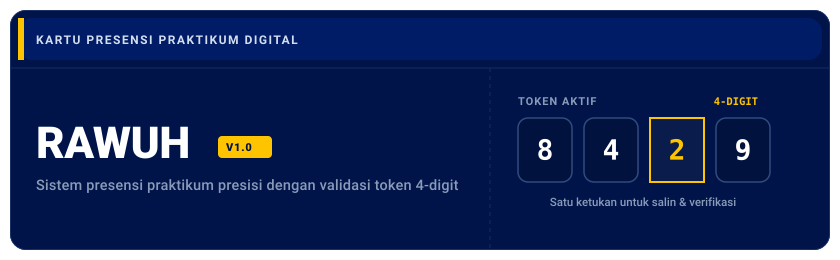

<p align="center">
  
</p>

<p align="center">
  <a href="https://docs.expo.dev/"></a>
  <a href="https://reactnative.dev/"></a>
  <a href="https://www.typescriptlang.org/"></a>
  <a href="https://zustand-demo.pmnd.rs/"></a>
  <a href="https://www.w3.org/WAI/WCAG21/quickref/"></a>
</p>

---

## Ringkasan Proyek

**Rawuh** adalah aplikasi mobile pencatatan kehadiran sesi praktikum berbasis **React Native** dan **Expo SDK 57**. Didesain dengan filosofi **"Kartu Mahasiswa" (Identity Card UI)** yang mengedepankan presisi visual tanpa dekorasi bayangan berlebih (zero-shadow), aplikasi ini berjalan secara offline-first dengan dua perspektif peran pengguna: **Asisten Lab** dan **Praktikan**.

> [!NOTE]
> Proyek dirancang dengan pola *parallel development without merge conflicts*—pemisahan ketat kepemilikan berkas antara tim antarmuka (UI Kit & Layar Asisten) dan tim logika (Store & Layar Praktikan).

---

## Fitur Utama

### 1. Peran Asisten Lab
- **Manajemen Sesi Praktikum:** Membuat sesi baru lengkap dengan topik bahasan, ruang lab, tanggal, dan durasi.
- **Generator Token 4-Digit:** Menghasilkan kode token numerik 4-digit acak saat sesi dibuka untuk dimasukkan praktikan.
- **Tutup & Batalkan Sesi:** Mengakhiri sesi yang sedang berjalan atau membatalkan sesi sebelum dimulai.
- **Rekap Kehadiran Realtime:** Memantau daftar praktikan yang sudah hadir, izin, sakit, atau alpa, lengkap dengan penghitungan persentase kehadiran per sesi.

### 2. Peran Praktikan
- **Jadwal Sesi Terstruktur:** Menampilkan daftar sesi terjadwal, dibuka, maupun yang telah selesai menggunakan daftar tunggal efisien (`FlatList`).
- **Verifikasi Token 4-Digit:** Input token 4 sel otomatis (*auto-focus & backspace navigation*) untuk memvalidasi kehadiran.
- **Aksi Cepat Tombol Bulat:** Tombol navigasi bawah tengah (*context-aware center button*) langsung membuka sesi aktif yang sedang dibuka.
- **Riwayat & Status Presensi:** Memantau riwayat kehadiran lengkap dengan lencana status (Hadir, Terlambat, Izin, Sakit, Alpa).

### 3. Switch Peran Instan
- Berganti konteks pengguna antara Asisten dan Praktikan kapan saja tanpa alur login/logout yang memperlambat demonstrasi.

---

## Sistem Desain: "Kartu Mahasiswa"

Aplikasi Rawuh mematuhi panduan desain ketat yang terdokumentasi di [DESIGN.md](./DESIGN.md):

| Elemen | Token / Nilai | Penerapan |
| :--- | :--- | :--- |
| **Warna Utama (Navy)** | `#00144A` | `AppBar`, kartu identitas, tombol primer |
| **Aksen (Kuning)** | `#FFC400` | Garis aksen kartu, status dibuka, hanya di atas navy |
| **Latar Belakang** | `#F4F6FB` | Warna dasar layar (kanvas aplikasi) |
| **Permukaan Kartu** | `#FFFFFF` | Kontainer baris sesi, input field, bottom sheet |
| **Border & Pemisah** | `#E5E7EB` (1px) | Pengganti drop-shadow / elevation |
| **Target Sentuh** | Minimal 44 × 44 pt | Aksesibilitas tap target (WCAG 2.5.5) |
| **Rasio Kontras** | Minimal 4.5:1 | Teks normal memenuhi standar WCAG AA |

---

## Struktur Direktori

```text
pertemuan-6/
├── assets/
│   └── branding/
│       ├── rawuh-animated-logo.svg   # Logo animasi SVG master untuk README
│       └── rawuh-mark.svg            # Ikon mark vektor Rawuh
├── src/
│   ├── app/                          # Expo Router file-based screens
│   │   ├── _layout.tsx               # Root layout & status bar provider
│   │   ├── index.tsx                 # Selector switch peran & profil
│   │   ├── asisten/                  # Alur & layar asisten lab
│   │   │   ├── index.tsx             # Beranda asisten & daftar sesi
│   │   │   ├── buat.tsx              # Form pembuatan sesi praktikum
│   │   │   └── sesi/[id].tsx         # Detail sesi & rekap kehadiran
│   │   └── praktikan/                # Alur & layar praktikan
│   │       ├── (tabs)/
│   │       │   ├── _layout.tsx       # Tab bar kustom dengan tombol tengah
│   │       │   ├── jadwal.tsx        # Layar jadwal sesi
│   │       │   └── riwayat.tsx       # Layar riwayat kehadiran
│   │       └── sesi/[id].tsx         # Layar input token 4-digit
│   ├── components/
│   │   ├── session/                  # Komponen domain sesi (SessionRow, CodeDisplay, StatusBadge)
│   │   └── ui/                       # Komponen atomik (AppBar, IdentityCard, Tile, CodeCells, Button)
│   ├── features/
│   │   ├── asisten/                  # Modul fitur asisten (RekapList, StatusActionSheet)
│   │   └── praktikan/                # Modul fitur praktikan (PraktikanTabBar, PresensiForm)
│   ├── store/                        # Zustand store (appStore.ts & selector)
│   └── theme/                        # Desain token (colors.ts, spacing.ts, typography.ts)
├── DESIGN.md                         # Spesifikasi lengkap desain sistem Rawuh
└── package.json
```

---

## Memulai Cepat

### Prasyarat
- Node.js versi 18 atau lebih baru.
- Aplikasi **Expo Go** pada perangkat fisik atau simulator Android / iOS.

### Instalasi Dependensi
```bash
npm install
```

### Menjalankan Server Pengembangan
```bash
npx expo start
```
- Tekan `a` untuk membuka Android Emulator.
- Tekan `i` untuk membuka iOS Simulator.
- Pindai kode QR menggunakan aplikasi **Expo Go** untuk pengujian langsung di ponsel.

---

## Verifikasi & Kualitas Kode

Jalankan serangkaian pemeriksaan kualitas kode sebelum melakukan pengiriman:

```bash
# Pemeriksaan tipe statis TypeScript
npx tsc --noEmit

# Pemeriksaan kesehatan konfigurasi dan SDK Expo
npx expo-doctor
```

> [!TIP]
> Seluruh antarmuka telah diverifikasi kompatibel pada Expo SDK 57 dan siap diadaptasi ke Expo SDK 58 tanpa perubahan arsitektur data.
